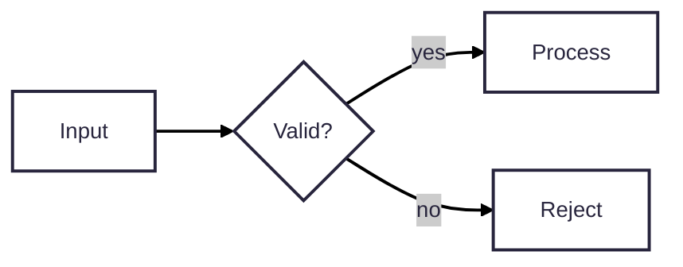

# Mermaid house style

All diagrams share one look: the mermaid.live default. White boxes, thick dark
borders, offset shadows, rounded step lines, black arrows, grey edge-label
tags, Recursive font.

## 1. Writing a diagram

Start **every** Mermaid diagram with this front-matter header, exactly:

```
---
config:
  theme: redux-color
---
```

Rules:

- Put the header in the source file itself. GitHub, VS Code and other viewers
  render Markdown as written, so the style must live in the file.
- Add no other config: no `layout: elk`, no `flowchart.curve`, no
  `themeVariables`, colours, fonts or `classDef` styling. The default layout
  produces the rounded step lines; ELK changes them.
- Keep labels short. Use `<br/>` for a second line. Boxes size to their text.
- Equal-size boxes only if asked. See [references/equal-boxes.md](references/equal-boxes.md).

Example:

````markdown

````

## 2. Rendering

Run the bundled script with Node.js. Paths are relative to this skill's folder:

```bash
node scripts/render.mjs diagram.mmd                # -> diagram.png next to it
node scripts/render.mjs diagram.mmd out.svg        # .png, .svg or .pdf
node scripts/render.mjs doc.md                     # each mermaid block -> doc-diagrams/diagram-NN.png
node scripts/render.mjs doc.md out/dir             # same, into a chosen folder
node scripts/render.mjs --check doc.md             # validate syntax only, keeps no files
```

- First run installs the pinned renderer into `scripts/node_modules` (one-time,
  about 200 MB with a headless browser). Later runs are offline.
- A diagram with no header gets `theme: redux-color` added at render time.
- Exit code is 1 if any diagram fails to parse; the error names the block.

## 3. Before saying a diagram is done

1. Run `--check` on the file, or render it.
2. If you can view images, open the PNG and look for cut-off text, arrowheads
   hidden under boxes, and overlapping labels. Fix the source and re-render.
3. Report the output path. Don't claim it looks right without viewing it.

## Notes

- Matches mermaid.live, which runs Mermaid 12.0.0 with `theme: redux-color`
  (neo look) and the Recursive Variable font. Viewers on older Mermaid
  versions, such as some GitHub renderers, may show the plain style. Render to
  PNG when the exact look matters.
- The font is embedded at render time from `assets/`, so no system font
  install is needed.
