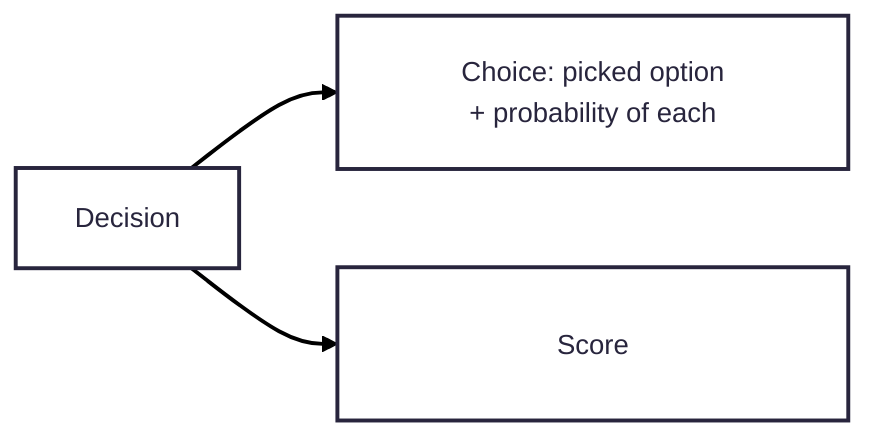

# Equal-size boxes

Mermaid sizes every box to fit its own text, so a row of outputs with
different label lengths comes out uneven. Mermaid has no setting for a fixed
box size.

Workaround: wrap each label in a fixed-size HTML block. Give every box in the
row the same width and height, and centre the text vertically:

- Set the width to fit the longest label in the row. Text that doesn't fit is
  cut off, not wrapped.
- Works in mermaid.live and the bundled renderer, which use HTML labels.
- GitHub and some other viewers strip inline styles, so the boxes go back to
  fitting their text there. Say so when you use it.
